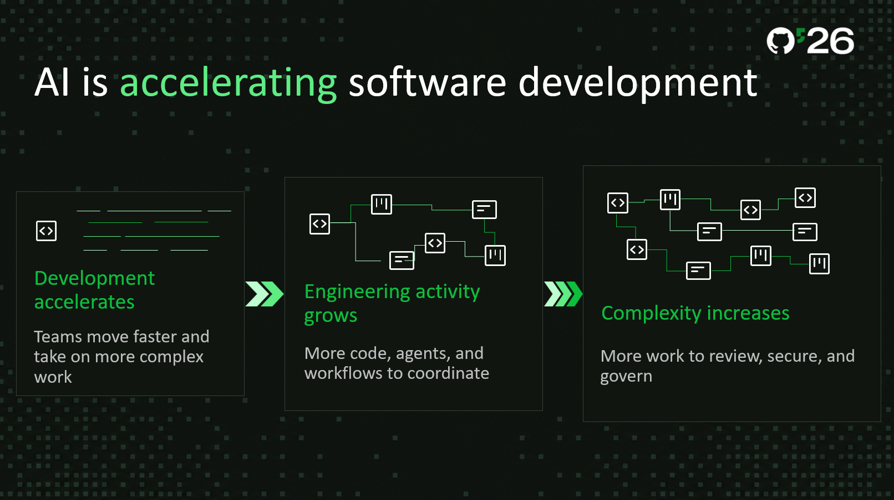

# AI is accelerating software development

{ .slide loading=lazy }

AI speeds up development in three steps, and each one creates the next problem:

1. **Development accelerates.** Teams move faster and take on more complex work.
2. **Engineering activity grows.** There is more code, more agents and more workflows to coordinate.
3. **Complexity increases.** There is more work to review, secure and govern.

## What this looks like in practice

GitHub reported more than 1.2 billion commits in a single week in October, over 400% more than a year earlier. That is the pressure behind this slide: more code means a longer review queue, so Universe focused on helping review and security keep pace.

Sources: [Beyond code generation: A developer's guide to agentic engineering](https://github.blog/ai-and-ml/github-copilot/beyond-code-generation-a-developers-guide-to-agentic-engineering/), [GitHub Universe 2026: Evolving every layer of the stack](https://github.blog/news-insights/company-news/github-universe-2026-evolving-every-layer-of-the-stack/)
