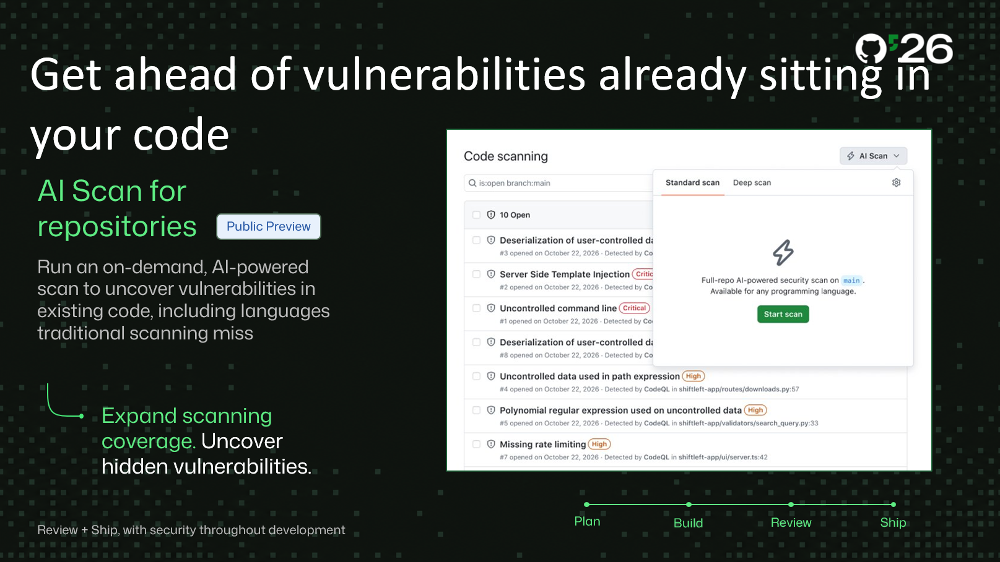

# Get ahead of vulnerabilities already in your code

{ .slide loading=lazy }

**AI Scan for repositories** (public preview) runs an on-demand, AI-powered scan to uncover vulnerabilities in existing code. It includes languages traditional scanning misses.

**Takeaway:** expand scanning coverage and uncover hidden vulnerabilities. It supports the Review and Ship stages.

## Details

- It scans the whole repository, not just pull request changes. It covers languages and frameworks CodeQL does not support, and can find issues rule-based analysis misses.
- Findings appear in the code scanning alert list alongside CodeQL alerts. Where both run, AI Scan skips issues CodeQL already reports.
- Users with write access to code scanning start a scan from the Code scanning page. Each scan analyses the latest commit on the default branch within a fixed time budget.
- An organisation owner or security manager turns it on once the enterprise has enabled the AI Scan policy. It is separate from AI Scan for pull requests.
- It is available for public repositories, and for private and internal repositories with GitHub Code Security or GitHub Advanced Security.

Sources: [AI Scan for repositories in public preview](https://github.blog/changelog/2026-10-28-ai-scan-for-repositories-in-public-preview/), [AI Scan for pull requests](https://docs.github.com/code-security/concepts/code-scanning/ai-powered-security-detections)
