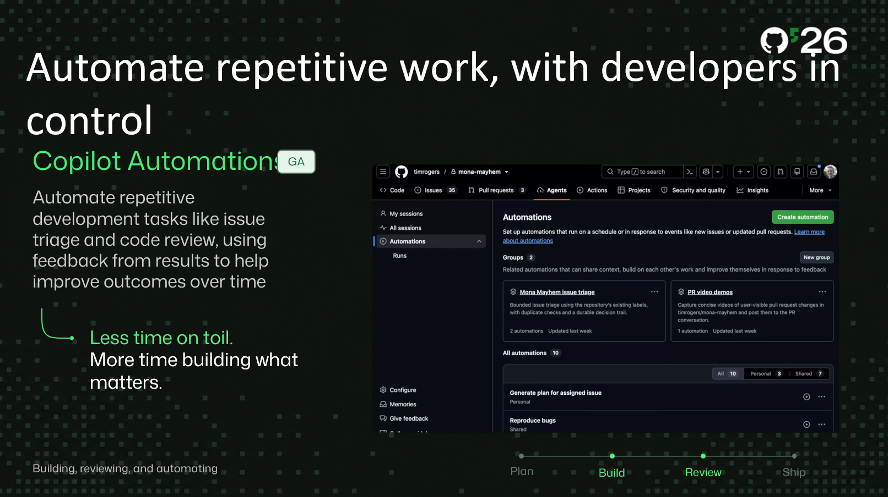

# Automate repetitive work, with developers in control

{ .slide loading=lazy }

**Copilot Automations** (generally available) automate repetitive development tasks such as issue triage and code review. They use feedback from results to improve outcomes over time.

**Takeaway:** less time on toil, more time building what matters.
