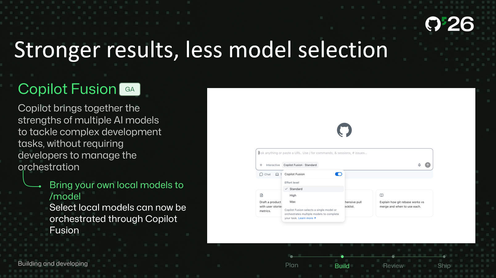

# Stronger results, less model selection

{ .slide loading=lazy }

**Copilot Fusion** (generally available) combines the strengths of multiple AI models to tackle complex development tasks. Developers do not have to manage the orchestration.

You can also bring your own local models to `/model`. Selected local models can now be orchestrated through Copilot Fusion.

## Effort levels

Selecting Copilot Fusion means choosing a system that routes and orchestrates models for each task, not a single model.

| Level | Best for |
| --- | --- |
| Fusion Standard | Everyday coding, with versatile models |
| Fusion High | Challenging tasks and deeper reasoning |
| Fusion Max | The most demanding tasks and complex reasoning |

- In the Artificial Analysis Coding Agent Index, Fusion Max scored within two points of Claude Code with Opus 5.5 Max, at about half the average API cost per task and about 40% less time.
- There is no separate charge for Fusion. You pay each model's standard rate for the models it uses, so High and Max can use more AI credits than Standard.
- Enterprise administrators can see which models Fusion picks from, disable models for Fusion only, and set Fusion as the default model.

Sources: [Route and orchestrate models with GitHub Copilot Fusion](https://github.blog/changelog/2026-10-28-route-and-orchestrate-models-with-github-copilot-fusion/), [About GitHub Copilot Fusion](https://docs.github.com/en/enterprise-cloud@latest/copilot/concepts/models/copilot-fusion)
