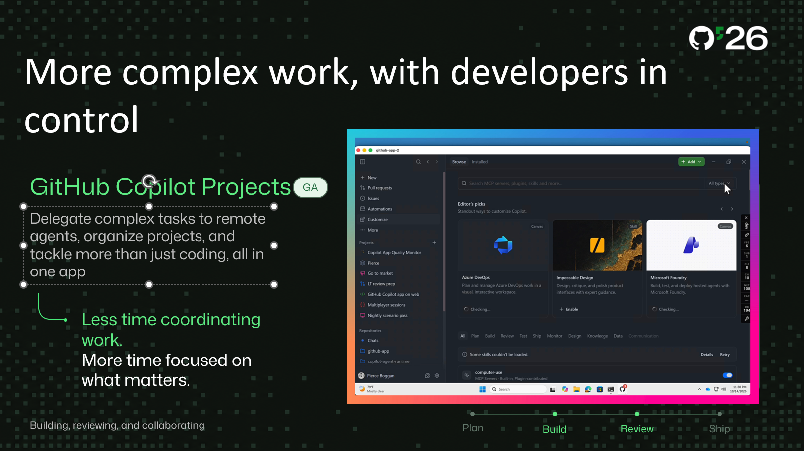

# More complex work, with developers in control

{ .slide loading=lazy }

**GitHub Copilot Projects** (public preview) lets you delegate complex tasks to remote agents, organise projects, and tackle more than just coding, all in one app.

**Takeaway:** less time coordinating work, more time focused on what matters. It supports the Build and Review stages.

## Details

Work does not always fit in a single repository or session. A project brings related work together over time. You give Copilot a goal and it coordinates the work, which can involve starting sessions, setting up recurring automations or creating artifacts. A project can span one or more repositories, or cover tasks that need no repository at all, such as investigating customer feedback.

In a project you can add supporting files to the **Library**, then follow progress in **Overview**, where work is grouped as Needs input, Open, Working or Done. To tackle a task in one repository, start a session from that repository instead.

!!! note "Slide correction"
    The slide labels Copilot Projects as GA. GitHub Docs states that projects in the GitHub Copilot app are in public preview and subject to change, so this site follows the docs.

Sources: [Working with projects in the GitHub Copilot app](https://docs.github.com/en/copilot/how-tos/github-copilot-app/working-with-projects), [GitHub Copilot app](https://docs.github.com/en/copilot/concepts/copilot-surfaces/github-copilot-app)
