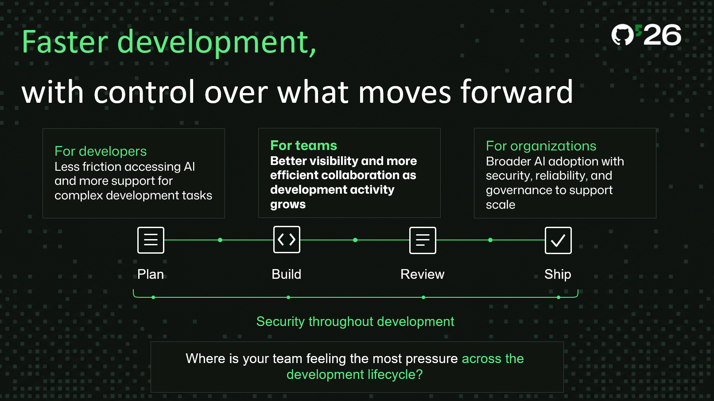

# Faster development, with control over what moves forward

{ .slide loading=lazy }

| Audience | Benefit |
| --- | --- |
| Developers | Less friction accessing AI and more support for complex development tasks |
| Teams | Better visibility and more efficient collaboration as development activity grows |
| Organisations | Broader AI adoption with security, reliability and governance to support scale |

**Question to reflect on:** where is your team feeling the most pressure across the development lifecycle?
