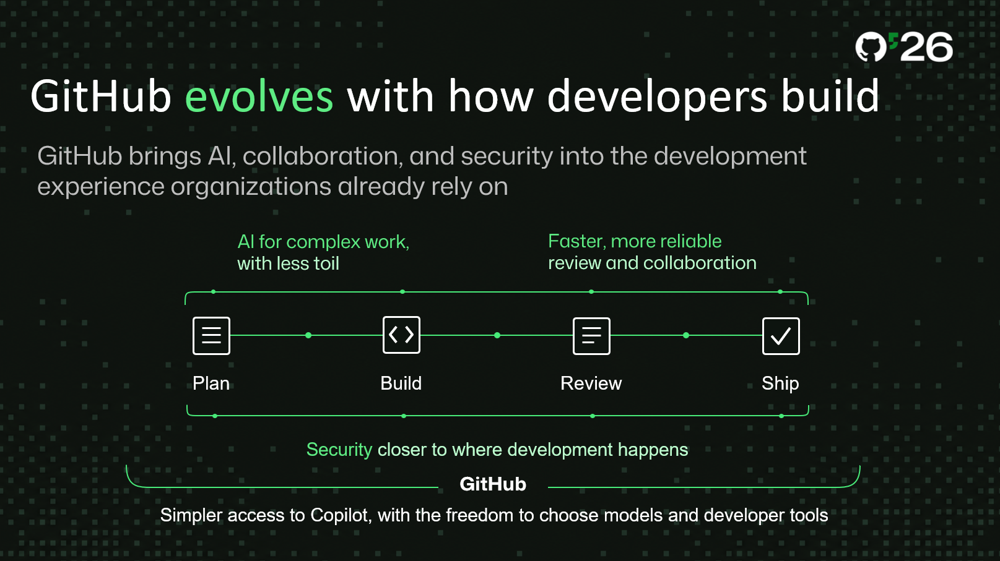

# GitHub evolves with how developers build

{ .slide loading=lazy }

GitHub brings AI, collaboration and security into the development experience organisations already rely on.

- **AI for complex work, with less toil** across Plan and Build.
- **Faster, more reliable review and collaboration** across Review and Ship.
- **Security closer to where development happens**, across the whole loop.
- **Simpler access to Copilot**, with the freedom to choose models and developer tools.
