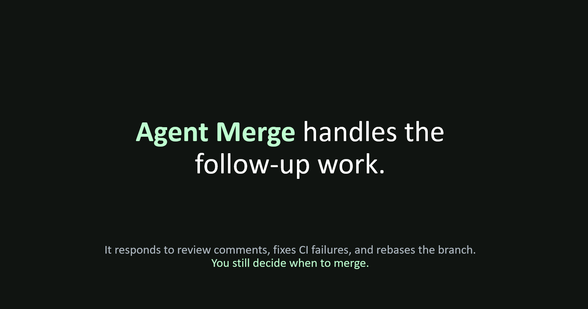

# Agent Merge handles the follow-up work

{ .slide loading=lazy }

Agent Merge responds to review comments, fixes CI failures, and rebases the branch. **You still decide when to merge.**

## On GitHub

Agent Merge is available in the GitHub Copilot app and VS Code, and is now built into pull requests on GitHub.

1. Open your pull request and select **Watch and fix** in the merge box.
2. Choose whether Copilot fixes failing Actions workflows, resolves merge conflicts, or both.
3. When a chosen blocker appears, Copilot starts work in a cloud development environment.

You can turn it on by default for every pull request you open in your Copilot settings. It does not enable auto-merge, but you can combine the two so GitHub merges as soon as all requirements are met. It does not support stacked pull requests or pull requests from forks.

Sources: [Agent Merge watches and fixes pull requests in the cloud](https://github.blog/changelog/2026-10-28-agent-merge-watches-and-fixes-pull-requests-in-the-cloud/), [Getting pull requests ready to merge with Agent Merge](https://docs.github.com/en/copilot/how-tos/copilot-on-github/use-copilot-agents/watch-and-fix-pull-requests)
