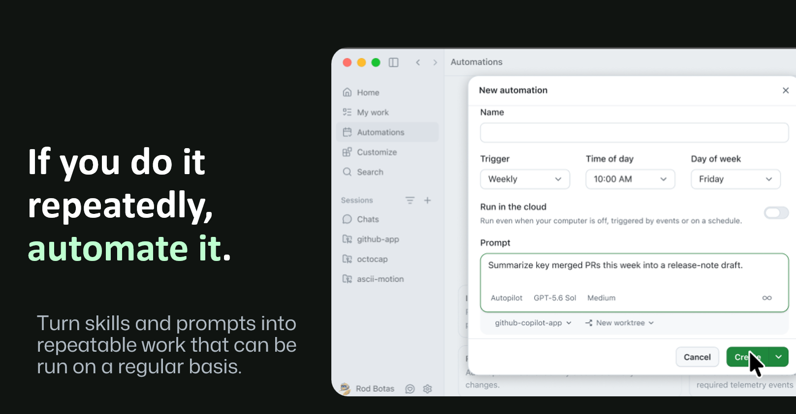

# If you do it repeatedly, automate it

{ .slide loading=lazy }

Turn skills and prompts into repeatable work that can run on a regular basis. The example automation runs weekly and summarises key merged pull requests into a release-note draft.

## Setting one up

- Choose a trigger: a schedule, an event on GitHub, or a manual run.
- Choose whether to run in the cloud, so it runs even when your computer is off.
- Decide what the automation may change during a run, for example anything in the repository.
- AI credits are charged either to you, with actions taken as your identity, or to the owner of the repository, with actions taken as Copilot.
- Group related automations so they share context and can propose improvements to each other.

Source: [Using automations in the GitHub Copilot app](https://docs.github.com/en/copilot/how-tos/github-copilot-app/using-automations)
