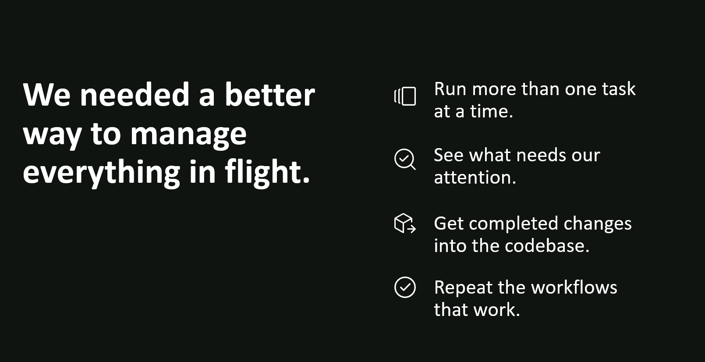

# We needed a better way to manage everything in flight

{ .slide loading=lazy }

What a better way needs to do:

- Run more than one task at a time.
- See what needs our attention.
- Get completed changes into the codebase.
- Repeat the workflows that work.

These map to the app's parallel sessions, projects, [Agent Merge](agent-merge.md) and [automations](automate.md).
