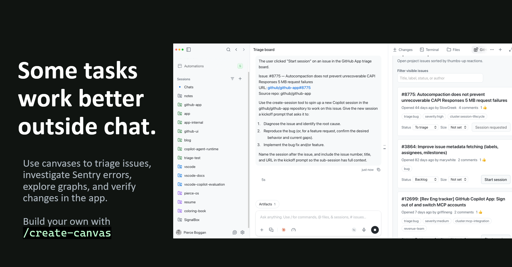

# Some tasks work better outside chat

{ .slide loading=lazy }

Use canvases to triage issues, investigate Sentry errors, explore graphs, and verify changes in the app.

Build your own with `/create-canvas`.

## What a canvas is

A canvas is a shared, interactive surface for a work artifact, such as a plan, triage board, dashboard, release checklist or spreadsheet. It is bidirectional: the agent can update it while it works, and you can edit the same surface. Canvases open in the app's right side panel.

To create one, type `/create-canvas` in a session and describe what people and the agent should be able to do. For example:

```text
/create-canvas Create an agentic kanban canvas with actions to create, assign, and move cards.
```

Canvas extensions live under `.github/extensions` (repository scope, shared with your team) or `~/.copilot/extensions` (user scope, personal). A canvas can ship inside a plugin alongside skills or MCP servers.

## Why use a canvas

Chat is good for defining intent. Most work happens in surfaces such as a terminal, browser, document or dashboard. A canvas lets you:

- Ground agent work in a real artifact.
- Steer or correct work directly, then let the agent continue from your changes.
- Inspect progress as visible changes, not just chat replies.
- Keep work continuous across turns, sessions and handoffs.

Use the **Customize** then **Canvas** view to browse featured canvases. The GitHub security extension provides a Security canvas for code scanning alerts.

Source: [Working with canvas extensions in the GitHub Copilot app](https://docs.github.com/en/copilot/how-tos/github-copilot-app/working-with-canvas-extensions)
