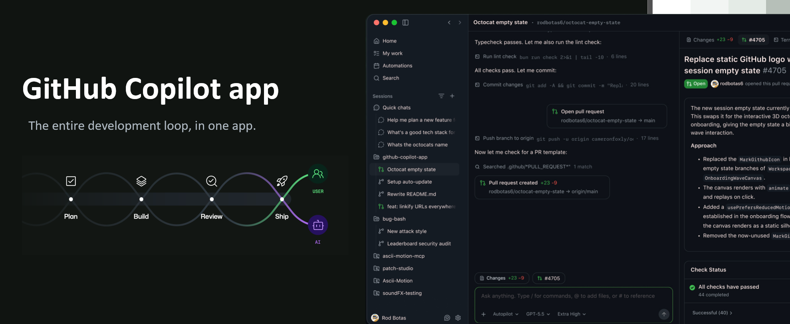

# The GitHub Copilot app

{ .slide loading=lazy }

**The entire development loop, in one app.** Plan, Build, Review and Ship are shared between you and AI, from the first chat to an open pull request with passing checks.
