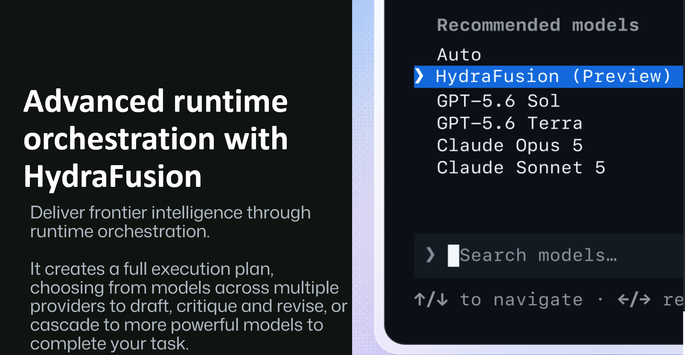

# Advanced runtime orchestration with HydraFusion

{ .slide loading=lazy }

HydraFusion (preview) delivers frontier intelligence through runtime orchestration. It creates a full execution plan, choosing from models across multiple providers to draft, critique and revise, or cascade to more powerful models to complete your task.
