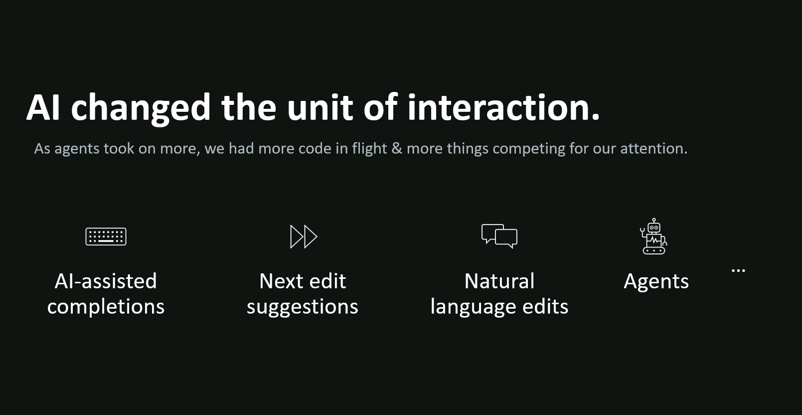

# AI changed the unit of interaction

{ .slide loading=lazy }

The unit of interaction has grown over time:

1. AI-assisted completions
2. Next edit suggestions
3. Natural language edits
4. Agents

As agents took on more, we had more code in flight and more things competing for our attention.
