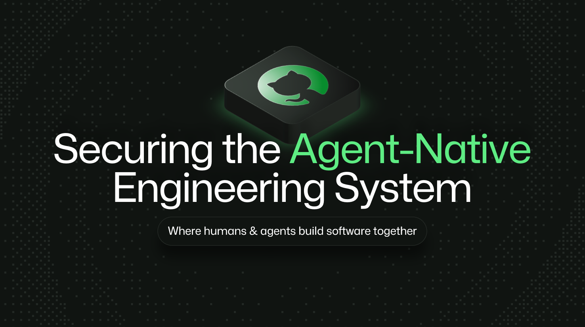

# Securing the Agent-Native Engineering System

{ .slide loading=lazy }

Chapter 3 opens with the idea that software is now built by humans and agents together, so security has to be built into that system rather than bolted on afterwards.

## Details

- Agents write code at machine speed, so checks must run at machine speed too.
- The chapters that follow walk from the agent loop through to enterprise-wide remediation.

Sources: [GitHub security features](https://docs.github.com/en/code-security/getting-started/github-security-features)
