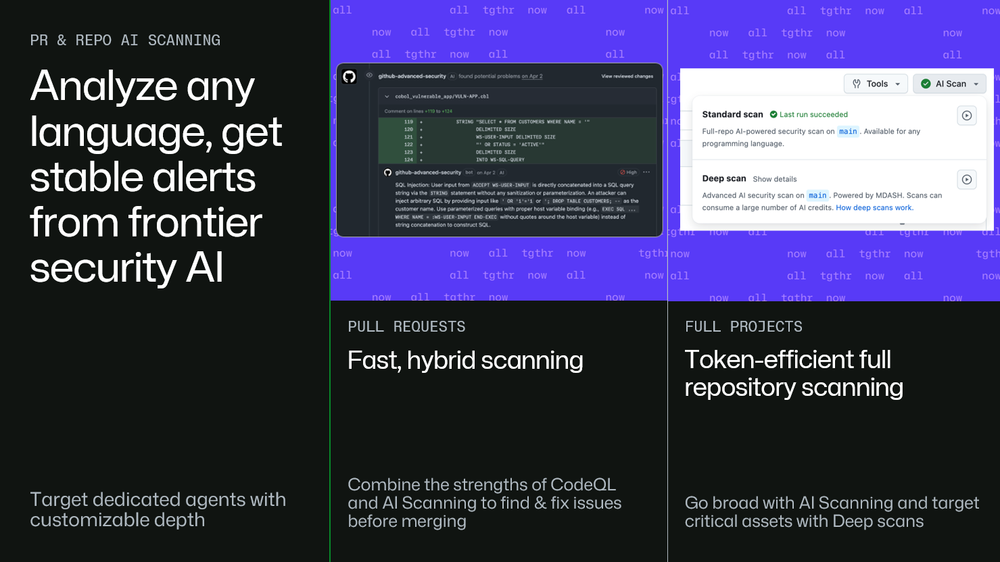

# Analyze any language, get stable alerts from frontier security AI

{ .slide loading=lazy }

Target dedicated agents with customisable depth.

## Details

- **Pull requests:** fast, hybrid scanning that combines the strengths of CodeQL and AI scanning to find and fix issues before merging.
- **Full projects:** token-efficient full repository scanning. Go broad with AI Scan, and target critical assets with Deep scans.
- **Standard scan:** a full-repo AI-powered security scan available for any programming language.
- **Deep scan:** an advanced AI security scan that can consume a large number of AI credits.

Sources: [AI Scan for repositories](https://github.blog/changelog/2026-10-28-ai-scan-for-repositories-in-public-preview/), [About code scanning](https://docs.github.com/en/code-security/code-scanning/introduction-to-code-scanning/about-code-scanning)
