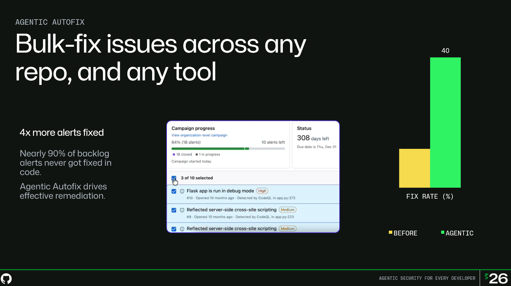

# Bulk-fix issues across any repo, and any tool

{ .slide loading=lazy }

Agentic autofix drives effective remediation, with 4x more alerts fixed according to the slide.

## Details

- Nearly 90% of backlog alerts never got fixed in code, per the slide.
- Select alerts in a security campaign and hand them to Copilot together.
- Agentic autofix for code scanning is generally available. It proposes a fix, reruns CodeQL to confirm the alert closes, then opens a pull request, and you can assign up to 25 alerts at once.

Sources: [Agentic autofix for code scanning alerts](https://github.blog/changelog/2026-10-15-agentic-autofix-for-code-scanning-alerts-general-availability/)
