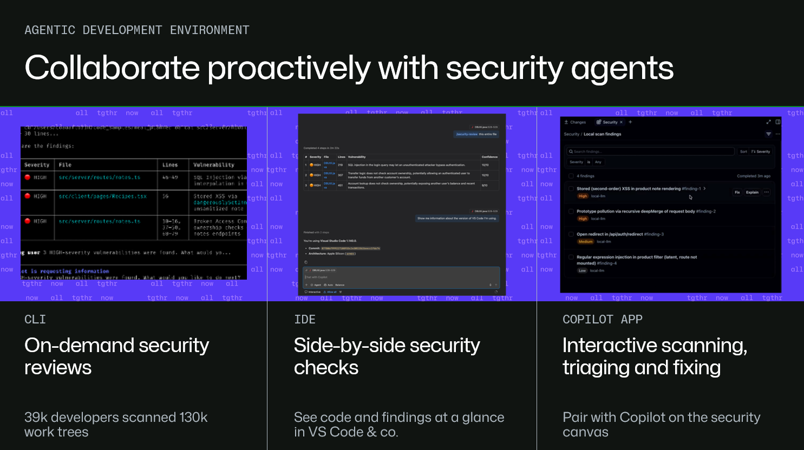

# Collaborate proactively with security agents

{ .slide loading=lazy }

Security agents meet you wherever you work.

## Details

- **CLI:** on-demand security reviews. Per the slide, 39k developers scanned 130k work trees.
- **IDE:** side-by-side security checks, seeing code and findings at a glance in VS Code and others.
- **Copilot app:** interactive scanning, triaging and fixing, pairing with Copilot on the security canvas.
- Trigger a review with `/security-review`. The Copilot app uses the security extension, which the changelog lists as public preview.

Sources: [GitHub Copilot app](https://docs.github.com/en/copilot/concepts/copilot-surfaces/github-copilot-app), [Security extension for the GitHub Copilot app](https://github.blog/changelog/2026-10-28-security-extension-for-the-github-copilot-app/)
