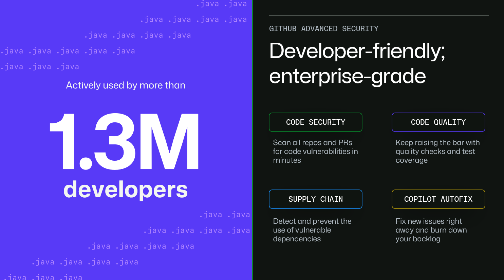

# Developer-friendly; enterprise-grade

{ .slide loading=lazy }

GitHub Advanced Security is actively used by more than 1.3M developers, according to the slide.

## Details

- **Code security:** scan all repos and PRs for code vulnerabilities in minutes.
- **Code quality:** keep raising the bar with quality checks and test coverage.
- **Supply chain:** detect and prevent the use of vulnerable dependencies.
- **Copilot Autofix:** fix new issues right away and burn down your backlog.

Sources: [About GitHub Code Security](https://docs.github.com/en/code-security/getting-started/github-security-features)
