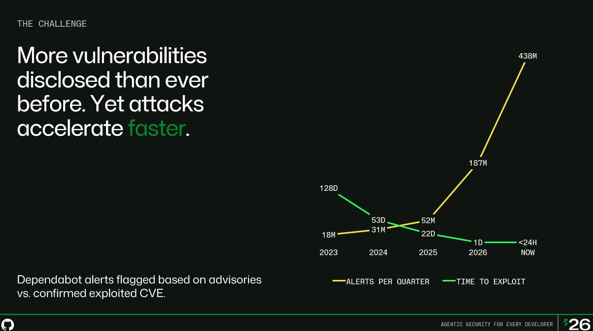

# More vulnerabilities disclosed, attacks accelerate faster

{ .slide loading=lazy }

The challenge: more vulnerabilities are disclosed than ever before, yet attacks accelerate faster.

## Details

- Per the slide, alerts per quarter grew from 18M (2023) to 438M (now).
- Time to exploit fell from 128 days to under 24 hours.
- The slide compares Dependabot alerts flagged from advisories with confirmed exploited CVEs.
- Dependabot alerts tell you when a dependency has a known vulnerability, which is the signal behind the alert counts.

Sources: [About Dependabot alerts](https://docs.github.com/en/code-security/dependabot/dependabot-alerts/about-dependabot-alerts)
