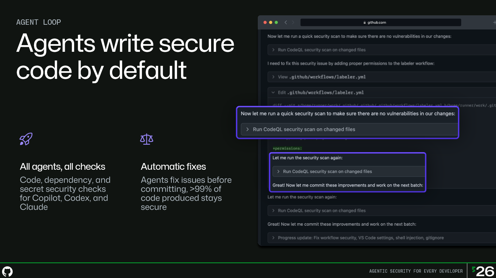

# Agents write secure code by default

{ .slide loading=lazy }

In the agent loop, security checks run while the agent works, before it commits.

## Details

- **All agents, all checks:** code, dependency and secret security checks for Copilot, Codex and Claude.
- **Automatic fixes:** agents fix issues before committing, and per the slide over 99% of code produced stays secure.
- In the screenshot the agent runs a CodeQL scan on changed files, fixes a workflow permissions issue, then scans again before committing.
- The slide's setting: on by default for all Cloud Agent jobs.

Sources: [About code scanning](https://docs.github.com/en/code-security/code-scanning/introduction-to-code-scanning/about-code-scanning), [Secret scanning](https://docs.github.com/en/code-security/concepts/secret-security/secret-scanning)
