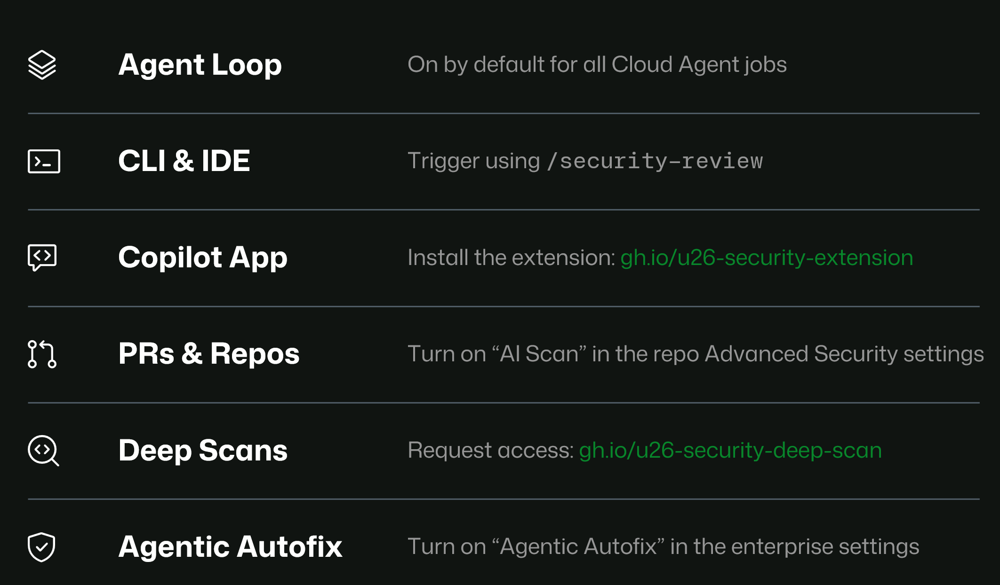

# Summary: how to turn it on

{ .slide loading=lazy }

Where to find each capability and how to switch it on.

## Details

- **Agent Loop:** on by default for all Cloud Agent jobs.
- **CLI and IDE:** trigger using `/security-review`.
- **Copilot app:** install the security extension.
- **PRs and repos:** turn on AI Scan in the repository's Advanced Security settings.
- **Deep scans:** request access through the link on the slide.
- **Agentic autofix:** turn on in the enterprise settings.

Sources: [Security extension for the GitHub Copilot app](https://github.blog/changelog/2026-10-28-security-extension-for-the-github-copilot-app/), [AI Scan for repositories](https://github.blog/changelog/2026-10-28-ai-scan-for-repositories-in-public-preview/)
