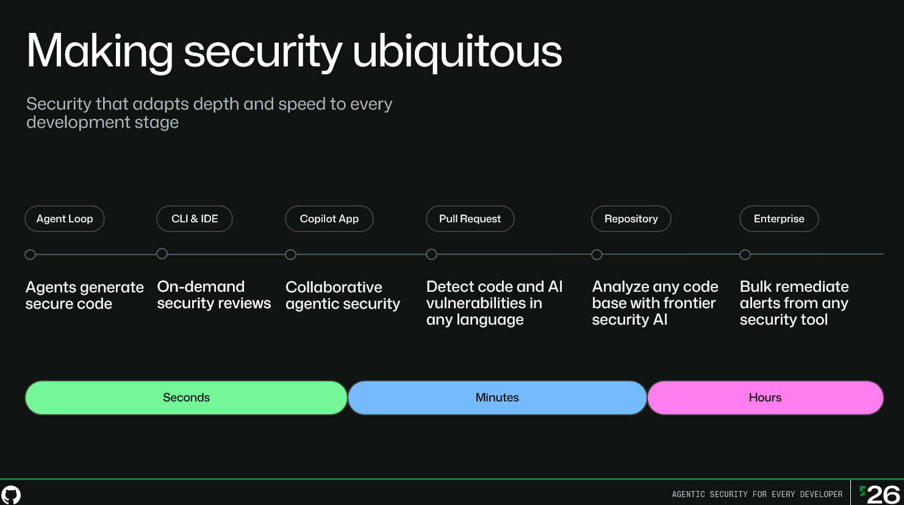

# Making security ubiquitous

{ .slide loading=lazy }

Security that adapts depth and speed to every development stage.

## Details

- The slide shows six stages, each with a different depth and speed.
- **Seconds:** Agent loop (agents generate secure code), CLI and IDE (on-demand security reviews), Copilot app (collaborative agentic security).
- **Minutes:** Pull request (detect code and AI vulnerabilities in any language).
- **Hours:** Repository (analyse any code base with frontier security AI) and Enterprise (bulk remediate alerts from any security tool).

Sources: [GitHub security features](https://docs.github.com/en/code-security/getting-started/github-security-features)
