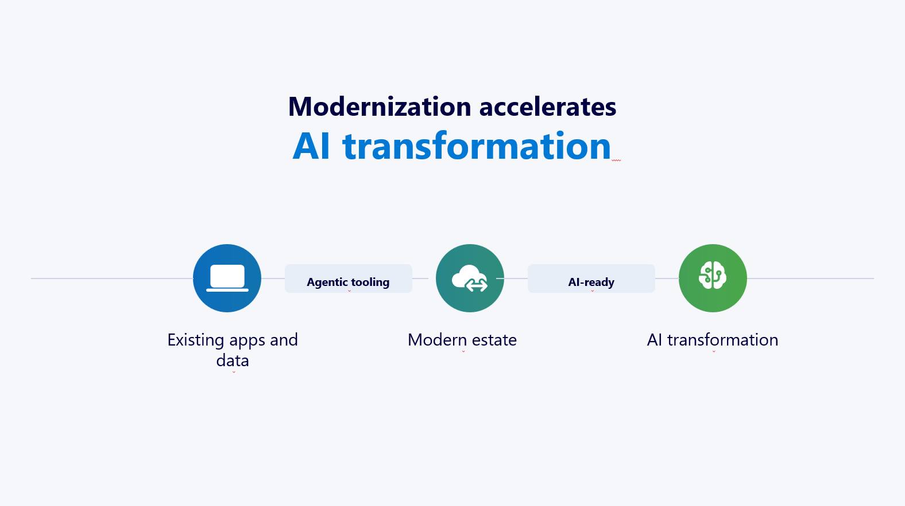

# Modernization accelerates AI transformation

{ .slide loading=lazy }

Modernizing existing applications is the route to AI transformation.

## Details

- Existing apps and data move to a modern estate with **agentic tooling**.
- A modern estate becomes **AI-ready**, which opens the way to AI transformation.
- GitHub Copilot modernization provides AI-powered capabilities to help modernize Java and .NET applications easily and confidently.

Sources: [modernize-cli README](https://github.com/microsoft/modernize-cli)
