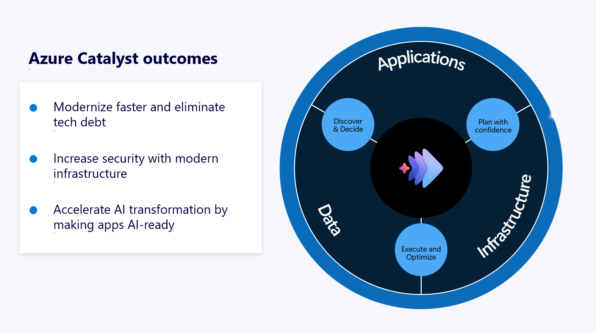

# Azure Catalyst outcomes

{ .slide loading=lazy }

What teams get from Azure Catalyst.

## Details

- Modernize faster and eliminate tech debt.
- Increase security with modern infrastructure.
- Accelerate AI transformation by making apps AI-ready.
- The work spans applications, data and infrastructure in three stages: **Discover and decide**, **Plan with confidence**, **Execute and optimize**.
