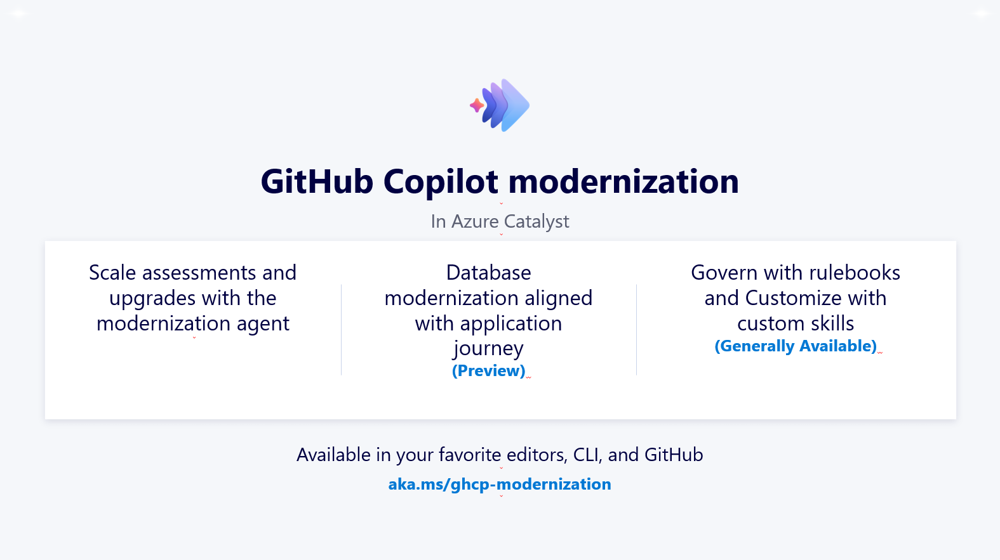

# GitHub Copilot modernization

{ .slide loading=lazy }

GitHub Copilot modernization sits inside Azure Catalyst and is available in your favourite editors, the CLI and GitHub.

## Details

- **Modernization agent:** scale assessments and upgrades across applications. It is delivered through the Modernize CLI.
- **Database modernization** aligned with the application journey, labelled Preview on the slide.
- **Rulebooks and custom skills:** govern and customise, labelled Generally Available on the slide.
- Architects define modernization standards once as reusable skills, then apply them consistently across many applications and repositories.
- Supports Java and .NET, on Windows, Linux and macOS.

Sources: [GitHub Copilot modernization CLI](https://github.com/microsoft/modernize-cli)
