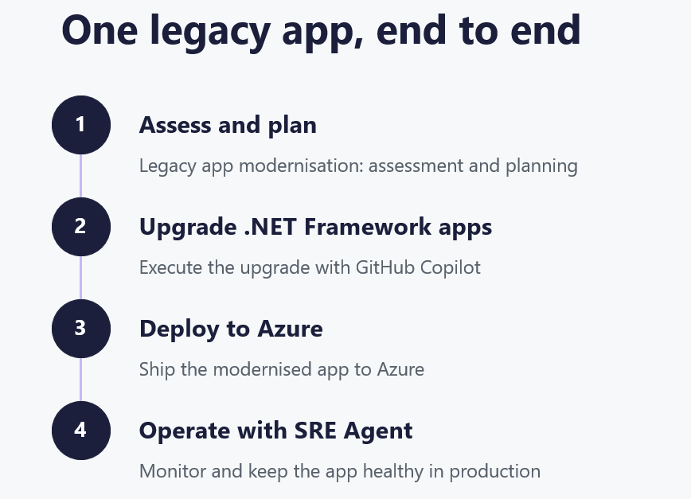

# One legacy app, end to end

{ .slide loading=lazy }

A single application followed through the whole journey.

## Details

- **Assess and plan:** legacy app modernisation, assessment and planning.
- **Upgrade .NET Framework apps:** execute the upgrade with GitHub Copilot.
- **Deploy to Azure:** ship the modernised app.
- **Operate with SRE Agent:** monitor and keep the app healthy in production.
