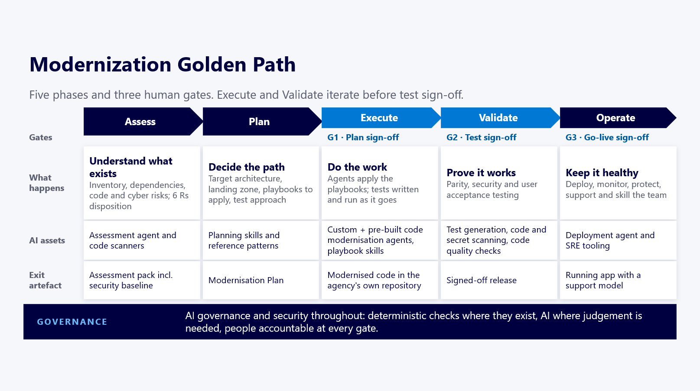

# Modernization Golden Path

{ .slide loading=lazy }

Five phases and three human gates. Execute and Validate iterate before test sign-off.

## Details

- **Assess:** understand what exists, including inventory, dependencies, code and cyber risks.
- **Plan:** decide the path, covering target architecture, landing zone and playbooks. Gate 1 is plan sign-off.
- **Execute:** agents apply the playbooks while tests are written and run.
- **Validate:** prove it works with parity, security and user acceptance testing. Gate 2 is test sign-off.
- **Operate:** deploy, monitor, protect and support. Gate 3 is go-live sign-off.
- Governance runs throughout: deterministic checks where they exist, AI where judgement is needed, and people accountable at every gate.

Sources: [GitHub Copilot modernization CLI](https://github.com/microsoft/modernize-cli)
