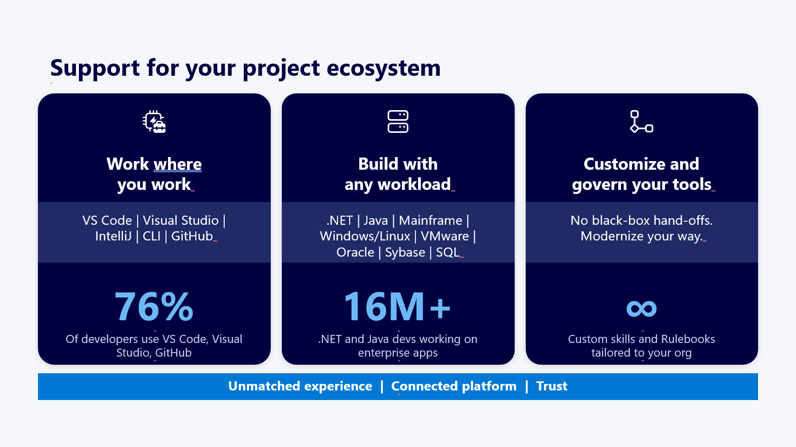

# Support for your project ecosystem

{ .slide loading=lazy }

Meet your projects where they already live.

## Details

- **Work where you work:** VS Code, Visual Studio, IntelliJ, CLI and GitHub. The slide says 76% of developers use VS Code, Visual Studio or GitHub.
- **Build with any workload:** .NET, Java, mainframe, Windows and Linux, VMware, Oracle, Sybase and SQL. The slide cites 16M+ .NET and Java developers on enterprise apps.
- **Customize and govern your tools:** custom skills and rulebooks tailored to your organisation, with no black-box hand-offs.
- The CLI runs on Windows, Linux and macOS, and needs Git and GitHub CLI 2.45.0 or later.

Sources: [GitHub Copilot modernization CLI](https://github.com/microsoft/modernize-cli)
