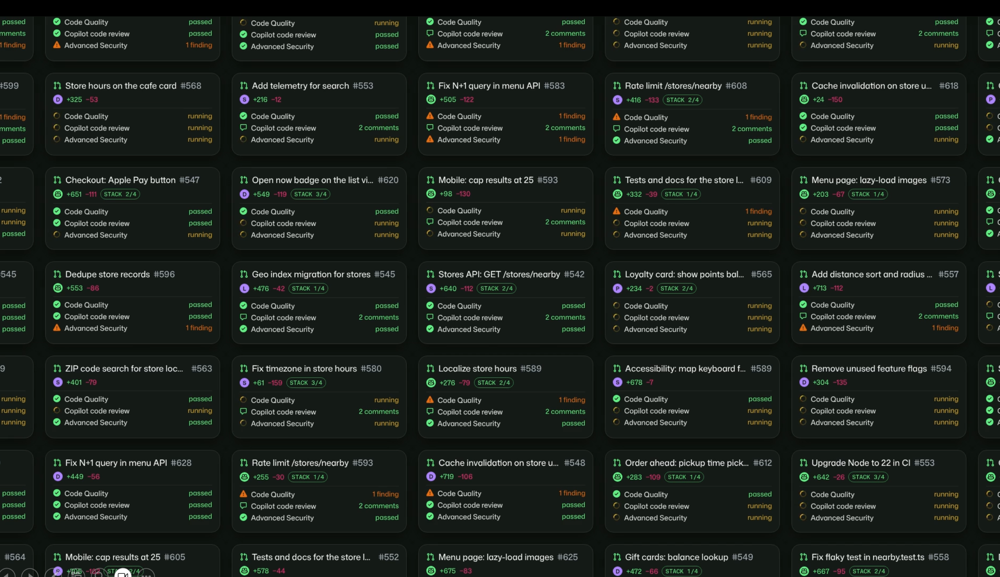
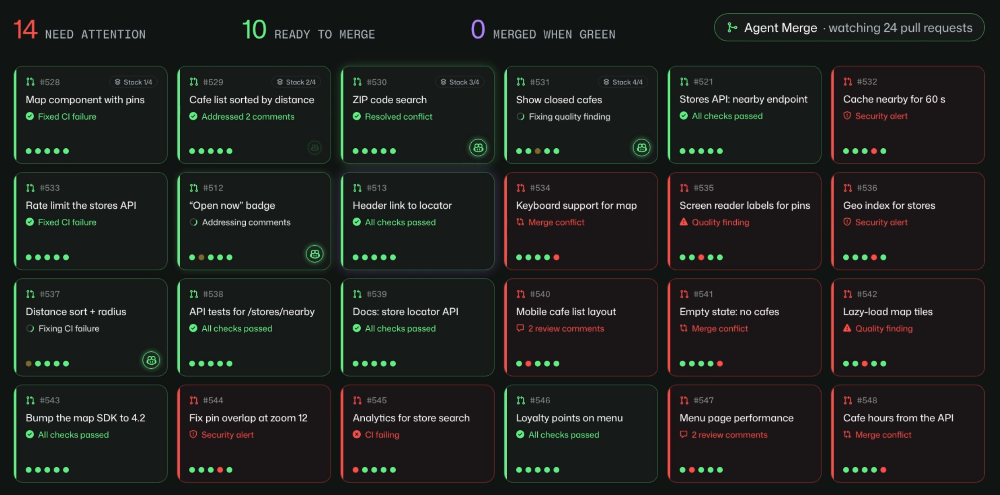

# Let Agent Merge keep work green

{ .slide loading=lazy }

Once every pull request has many automated checks, the burden shifts from the first review to keeping track of every change and responding to feedback.

{ .slide loading=lazy }

Agent Merge watches pull requests in the background and can:

- fix GitHub Actions failures;
- address Copilot Code Review comments;
- address review feedback from people;
- resolve merge conflicts;
- merge automatically once configured checks pass.

The person remains in control of policy and approval. Automation removes the routine waiting and follow-up work around a change.

Source: [Getting pull requests ready to merge with Agent Merge](https://docs.github.com/en/copilot/how-tos/copilot-on-github/use-copilot-agents/watch-and-fix-pull-requests)
