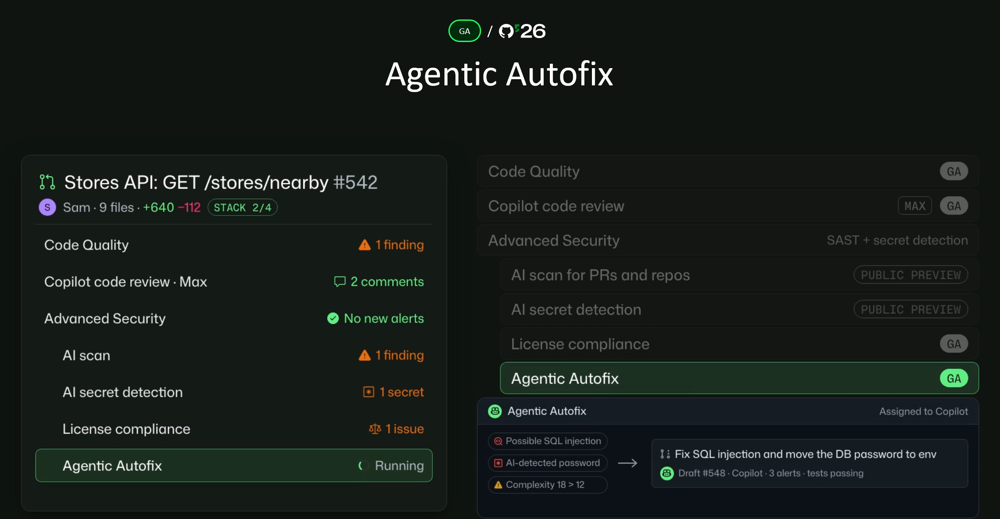

# Agentic Autofix

{ .slide loading=lazy }

Findings from every check feed one fix.

## Details

- Labelled GA on the slide.
- Three findings (SQL injection, an AI-detected password and complexity 18 over 12) become a single draft pull request with tests passing.
- See [Bulk-fix issues](../chapter-3/bulk-fix.md).

Sources: [About code scanning](https://docs.github.com/en/code-security/code-scanning/introduction-to-code-scanning/about-code-scanning)
