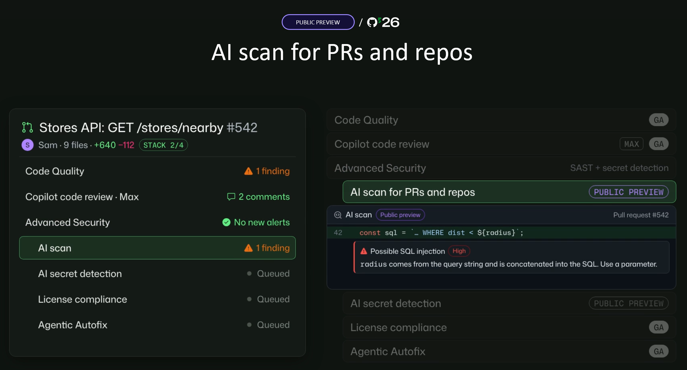

# AI scan for PRs and repos

{ .slide loading=lazy }

AI-powered scanning of pull requests and whole repositories.

## Details

- Labelled public preview on the slide.
- The example finding: `radius` comes from the query string and is concatenated into the SQL, so use a parameter.
- See [AI Scan for repositories](../chapter-1/ai-scan.md) and [Analyze any language](../chapter-3/analyze-any-language.md).

Sources: [About code scanning](https://docs.github.com/en/code-security/code-scanning/introduction-to-code-scanning/about-code-scanning)
