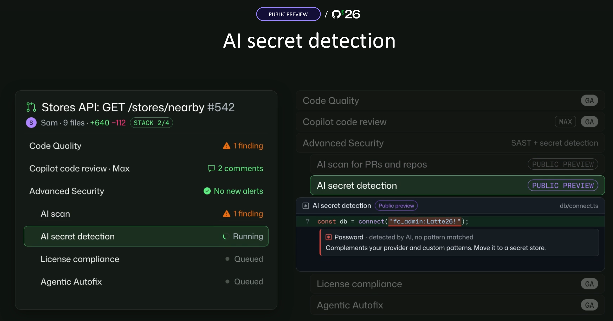

# AI secret detection

{ .slide loading=lazy }

Finds credentials that regular patterns miss, and complements provider and custom patterns.

## Details

- Labelled public preview on the slide.
- The example: a password detected by AI, with no pattern matched. Move it to a secret store.

Sources: [Secret scanning](https://docs.github.com/en/code-security/concepts/secret-security/secret-scanning)
