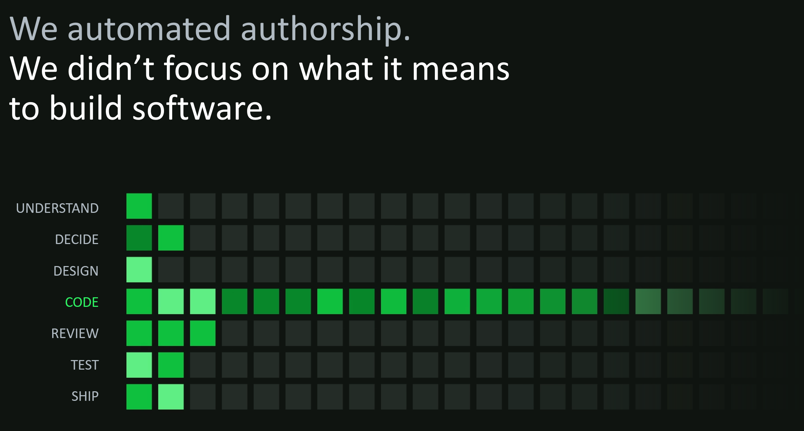

# We automated authorship

{ .slide loading=lazy }

Writing code sped up, while the rest of the process stayed at human pace.

## Details

- The slide's stages are Understand, Decide, Design, Code, Review, Test and Ship.
- Only the **Code** stage scaled up. The other stages did not.
