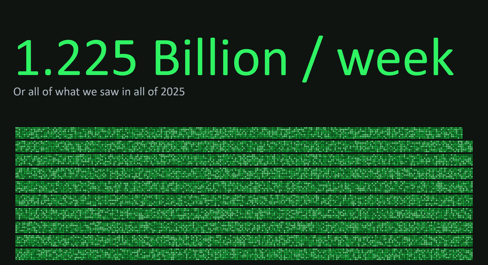

# 1.225 billion commits a week

{ .slide loading=lazy }

Volume has changed by orders of magnitude.

## Details

- The slide shows **1.225 billion commits per week**, which it says equals all of what GitHub saw in all of 2025.
