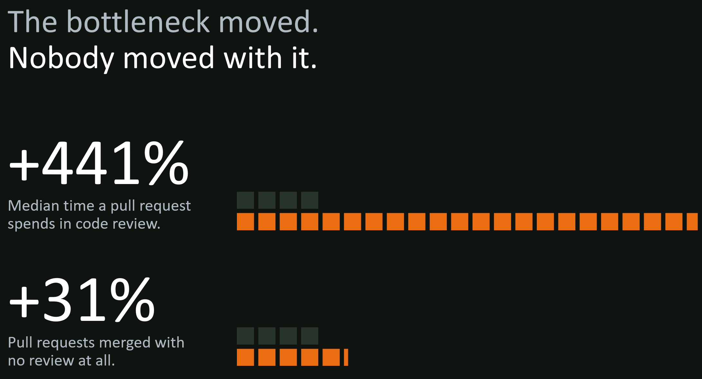

# The bottleneck moved

{ .slide loading=lazy }

Review, not authorship, is now the constraint.

## Details

- Median time a pull request spends in code review: **+441%**, per the slide.
- Pull requests merged with no review at all: **+31%**, per the slide.
