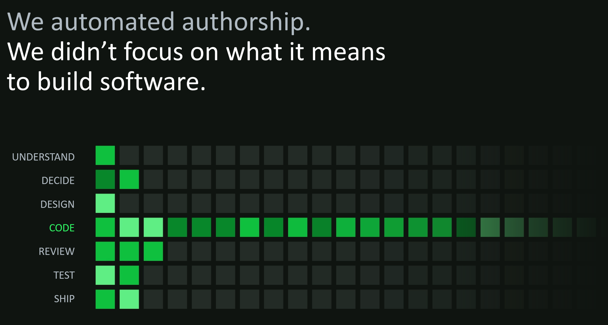
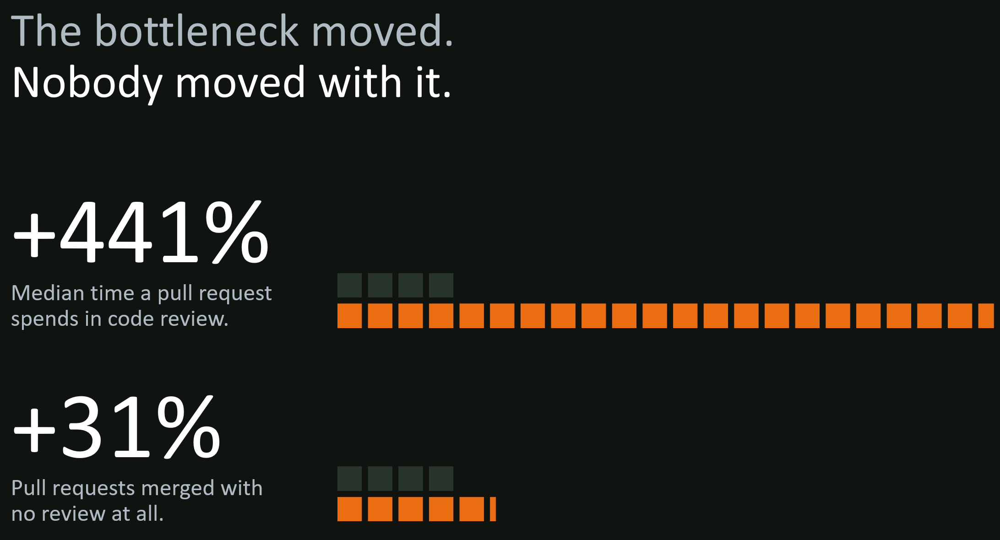

# The bottleneck moved

{ .slide loading=lazy }

Generating code is one step in a much larger system. A team still has to understand the problem, decide what matters, design a solution, review it, test it and ship it safely.

<video class="slide" controls preload="metadata" aria-label="Code generation got cheap">
  <source src="../assets/40-Code%20Gen%20got%20cheap.mp4" type="video/mp4">
</video>

<video class="slide" controls preload="metadata" aria-label="Verification did not">
  <source src="../assets/40a-verification%20didnot.mp4" type="video/mp4">
</video>

{ .slide loading=lazy }

Faros AI's 2026 *Acceleration Whiplash* study found that median time in code review increased by about 441% in periods of high AI adoption. It also found more pull requests merged without review. These figures describe the organizations studied; they are not GitHub-wide averages.

## The shift

- Generation became cheap.
- Verification did not.
- More reviewers working faster is not the only answer.
- Better checks, clearer context and agent-assisted verification are needed before a change reaches a person.

Source: [The Acceleration Whiplash](https://www.faros.ai/blog/2026-acceleration-whiplash)
