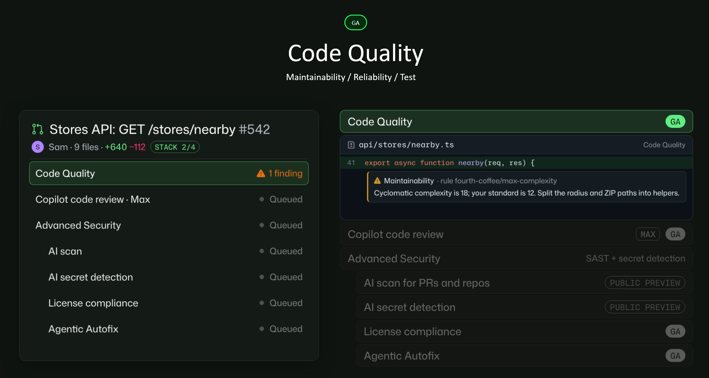

# Code Quality

{ .slide loading=lazy }

Maintainability, reliability and test coverage checks on every pull request.

## Details

- Labelled GA on the slide.
- The example finding: cyclomatic complexity is 18 but the team standard is 12, so split the radius and ZIP paths into helpers.
- The slide shows the whole stack of checks: Code Quality, Copilot code review, Advanced Security (AI scan, AI secret detection, license compliance, Agentic Autofix).

Sources: [About GitHub Code Quality](https://docs.github.com/en/code-security/code-quality/concepts/about-code-quality)
