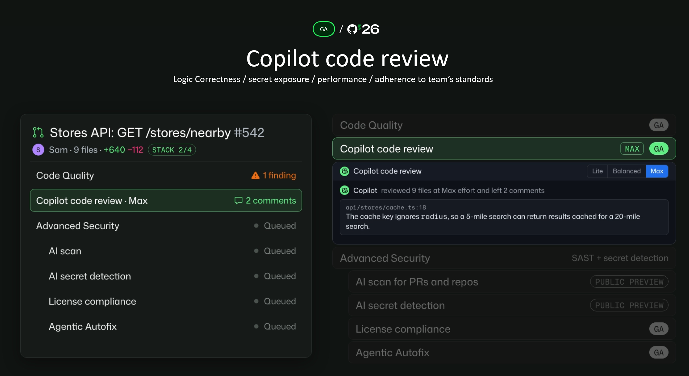

# Copilot code review

{ .slide loading=lazy }

Logic correctness, secret exposure, performance and adherence to the team's standards.

## Details

- Labelled GA on the slide, with effort levels **Lite**, **Balanced** and **Max**.
- The example comment: the cache key ignores `radius`, so a 5-mile search can return results cached for a 20-mile search.

Sources: [About Copilot code review](https://docs.github.com/en/copilot/concepts/agents/code-review)
