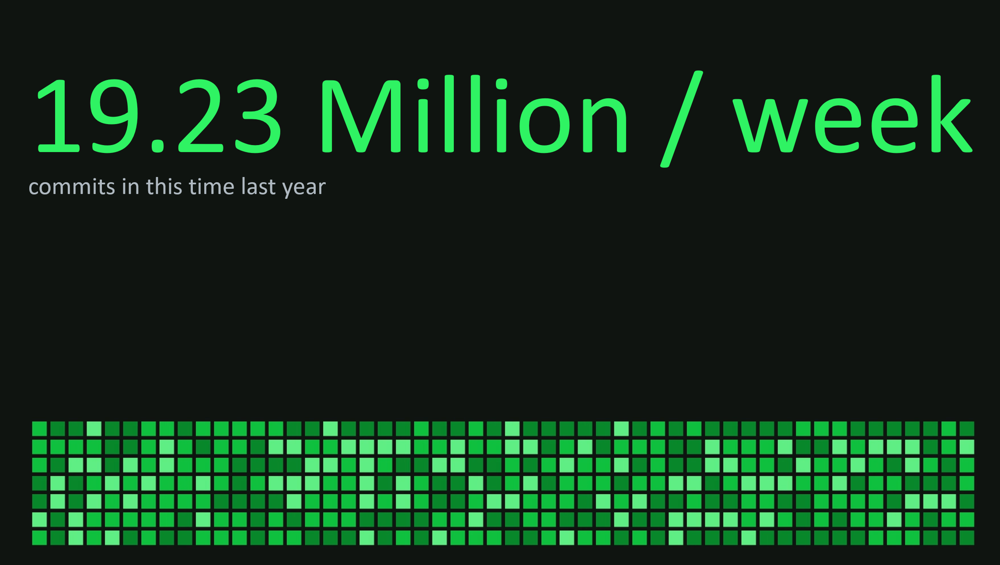

# How many commits did GitHub receive last year?

{ .slide loading=lazy }

A warm-up question, then the answer.

## Details

- This time last year GitHub received **19.23 million commits per week**, per the slide.
