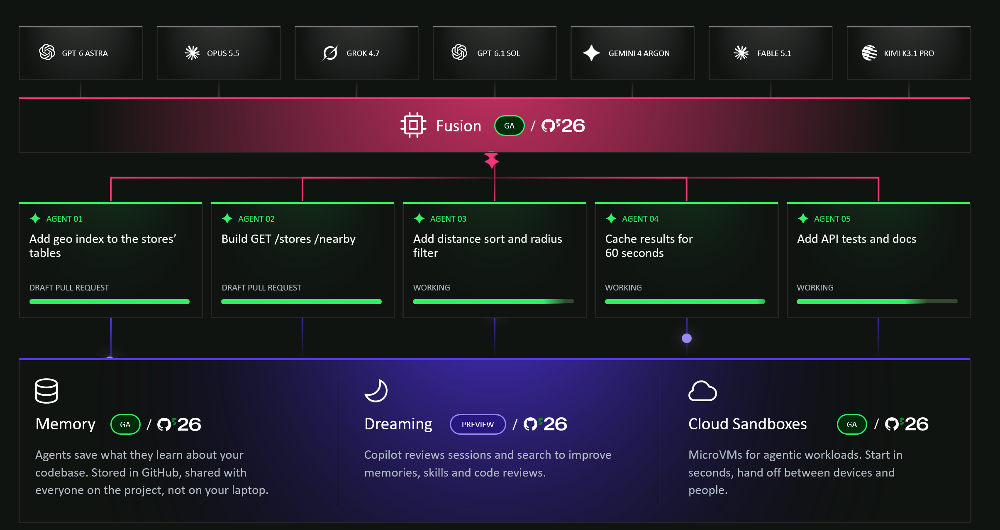

# Fusion across many models

{ .slide loading=lazy }

Fusion coordinates several models so each agent task gets the right one.

## Details

- The slide lists GPT-6 Astra, Opus 5.5, Grok 4.7, GPT-6.1 Sol, Gemini 4 Argon, Fable 5.1 and Kimi K3.1 Pro.
- Agents show progress as working or draft pull request.
- See [Copilot Fusion](../chapter-1/copilot-fusion.md) for the details and effort levels.
