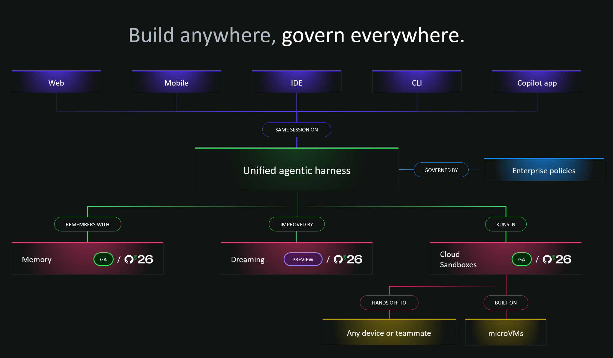

# Build anywhere, govern everywhere

{ .slide loading=lazy }

One harness, many surfaces, one set of policies.

## Details

- The same session runs on web, mobile, IDE, CLI and the Copilot app.
- The unified agentic harness is **governed by enterprise policies**.
- It remembers with Memory (GA), is improved by Dreaming (Preview) and runs in Cloud Sandboxes (GA), built on microVMs that can hand off to any device or teammate.

Sources: [Managing policies and features for Copilot](https://docs.github.com/en/copilot/how-tos/administer-copilot/manage-for-enterprise/manage-enterprise-policies)
