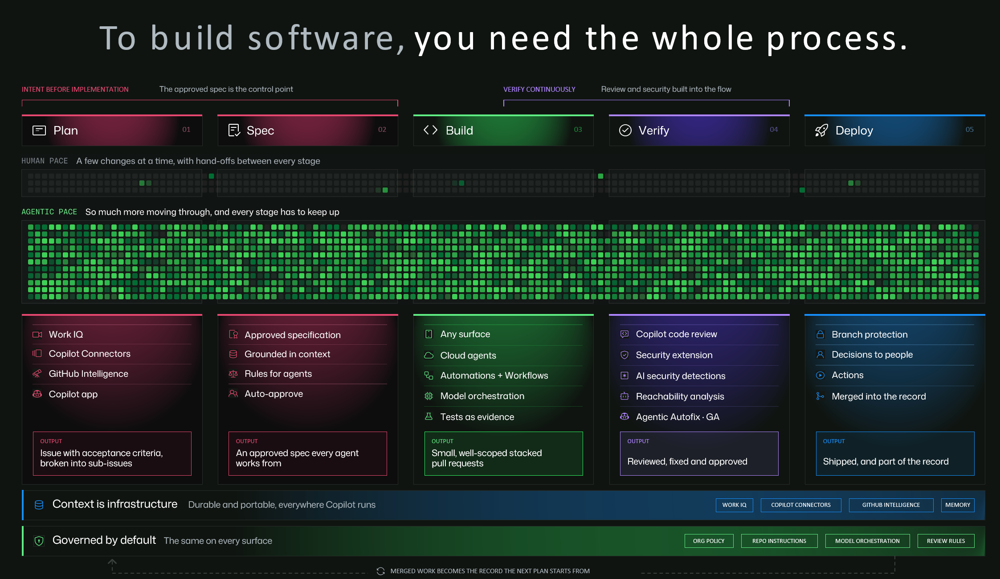

# Human pace and agentic pace

{ .slide loading=lazy }

The same process, at two speeds.

## Details

- **Human pace:** a few changes at a time, with hand-offs between every stage.
- **Agentic pace:** so much more moving through, and every stage has to keep up.
