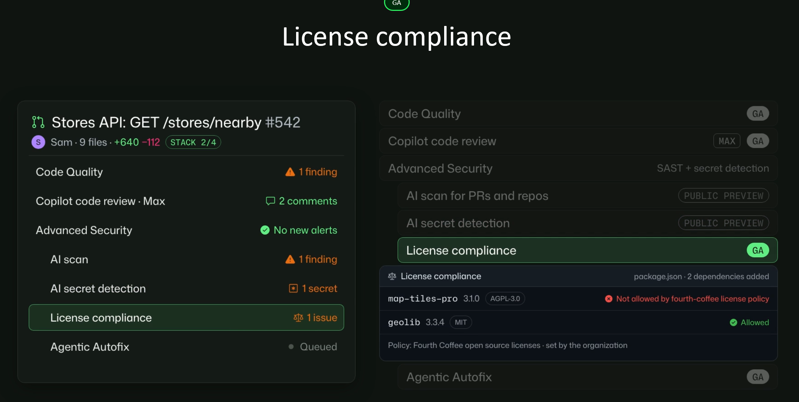

# License compliance

{ .slide loading=lazy }

Dependencies are checked against your organisation's open source license policy.

## Details

- Labelled GA on the slide.
- The example: `map-tiles-pro` under AGPL-3.0 is not allowed by the policy, while `geolib` under MIT is allowed.

Sources: [About dependency review](https://docs.github.com/en/code-security/supply-chain-security/understanding-your-software-supply-chain/about-dependency-review)
