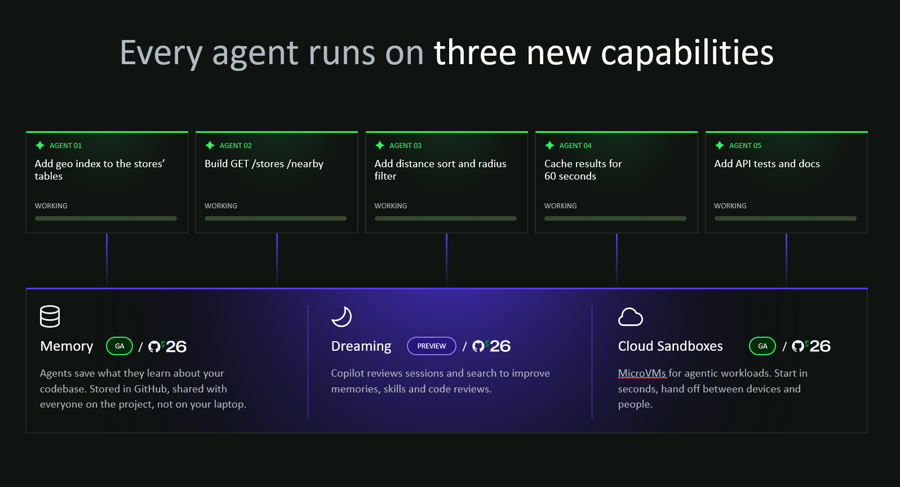

# Every agent runs on three new capabilities

{ .slide loading=lazy }

Many agents work in parallel, all backed by the same three capabilities.

## Details

- **Memory (GA):** agents save what they learn about your codebase. It is stored in GitHub and shared with everyone on the project, not on your laptop.
- **Dreaming (Preview):** Copilot reviews sessions and searches to improve memories, skills and code reviews.
- **Cloud Sandboxes (GA):** microVMs for agentic workloads. Start in seconds and hand off between devices and people.

Sources: [About agentic memory](https://docs.github.com/en/copilot/concepts/agents/copilot-memory)
