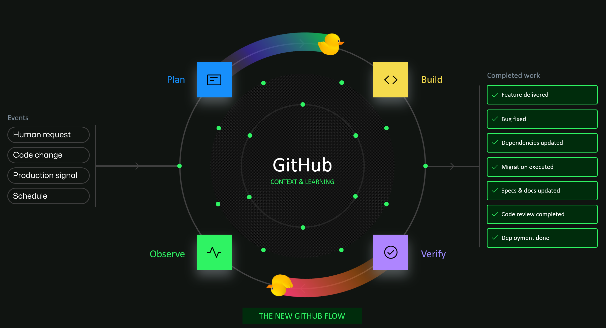

# The new GitHub flow

{ .slide loading=lazy }

Work becomes a loop driven by events, with GitHub holding the context.

## Details

- **Events in:** human request, code change, production signal, schedule.
- **Loop:** Plan, Build, Verify, Observe, around GitHub context and learning.
- **Completed work out:** feature delivered, bug fixed, dependencies updated, migration executed, specs and docs updated, code review completed, deployment done.
- Schedules and code changes can start work through [Copilot automations](../chapter-1/copilot-automations.md).

Sources: [Copilot cloud agent](https://docs.github.com/en/copilot/concepts/agents/about-copilot-cloud-agent)
