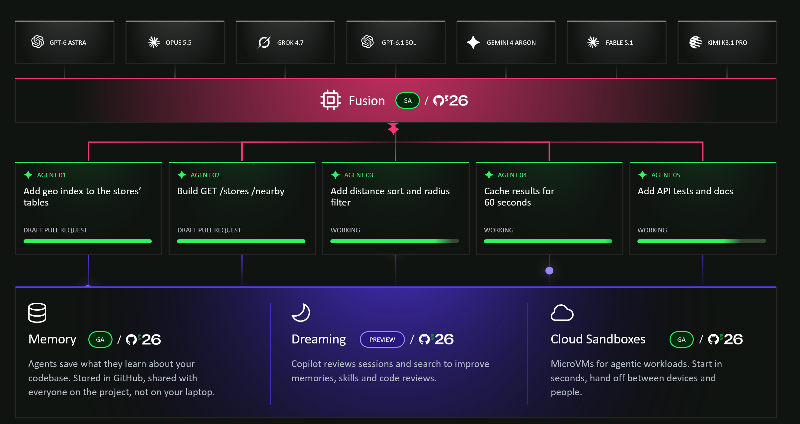

# Parallel agents and continuous context

{ .slide loading=lazy }

A useful agentic engineering flow carries context through planning, building, verification and observation. An event can begin with a person's request, a code change or a production signal. The outcome is work that is complete and trusted.

{ .slide loading=lazy }

## Three capabilities change the session

- **Memory:** carry learning about the codebase and project forward.
- **Dreaming:** review sessions and improve memories and code-review behavior over time.
- **Cloud sandboxes:** run agent work in isolated environments that continue between devices.

{ .slide loading=lazy }

The GitHub Copilot harness uses Fusion to route work across models, while the same session and project context remain available to the team.

{ .slide loading=lazy }

The Copilot app, IDE, CLI and web surfaces can share the unified agentic harness. Enterprise policies can govern memory, model orchestration and execution consistently across those surfaces.
