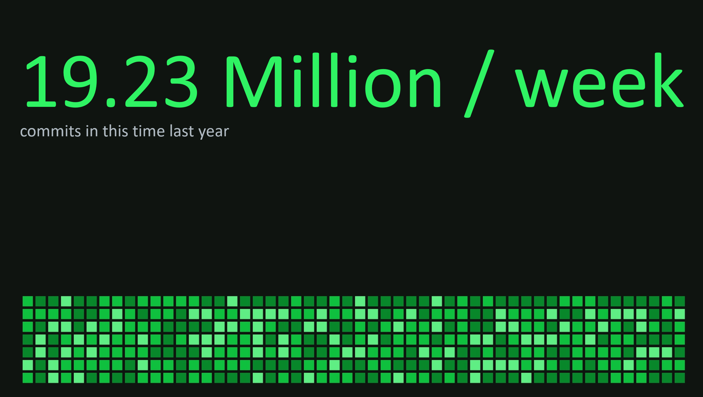
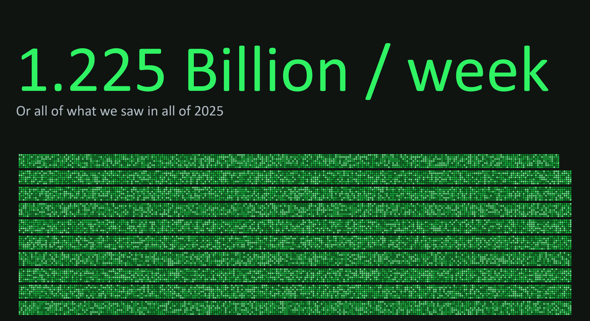

# The scale of change

{ .slide loading=lazy }

The first question is not whether developers can generate more code. The barrier to creating code has dropped dramatically.

{ .slide loading=lazy }

In one year, weekly GitHub commit activity moved from tens of millions to more than a billion.

{ .slide loading=lazy }

More commits mean it is easier to start work. They do not automatically mean organizations deliver more useful work.

## The useful question

Ask whether more code means more:

- features in customers' hands;
- bugs fixed;
- dependencies updated;
- changes reviewed and verified;
- software shipped safely.
