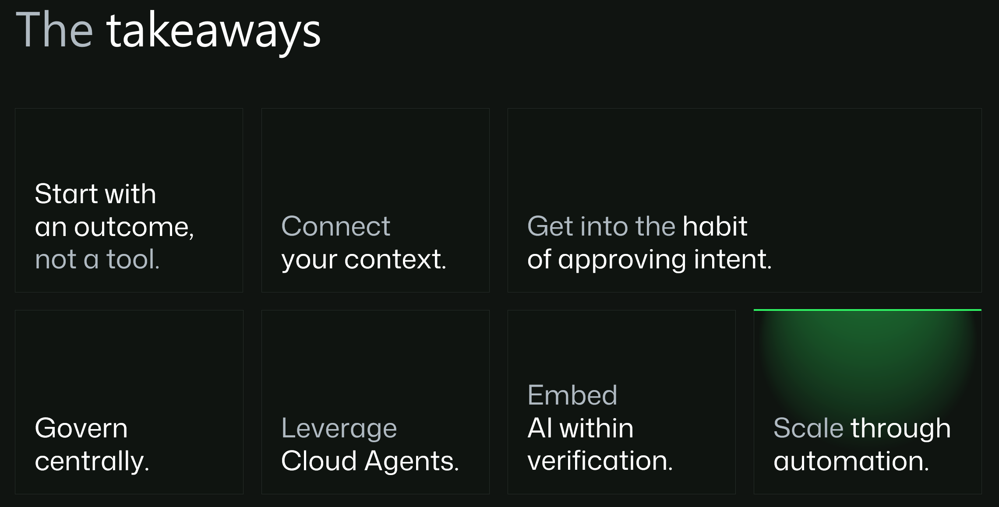

# The takeaways

{ .slide loading=lazy }

## Start with an outcome

Do not start with a tool or a model. Start with accepted criteria, observable outcomes and a decision that has enough context to execute.

## Connect your context

Bring code, project, business, observability and team context into planning. Context belongs outside the editor too.

## Approve intent

For larger tasks, make approval a habit: the team approves the plan and boundaries before agents begin broad implementation.

## Govern centrally

Carry policy and guardrails across Copilot surfaces instead of recreating them for every repository or team.

## Leverage cloud agents

Give agents isolated environments and continuous sessions. Scale their work across projects without tying them to one laptop or one meeting.

## Scale through verification

Use stacked pull requests and automated review, quality, security, license and merge workflows so agentic throughput produces more trustworthy software.
