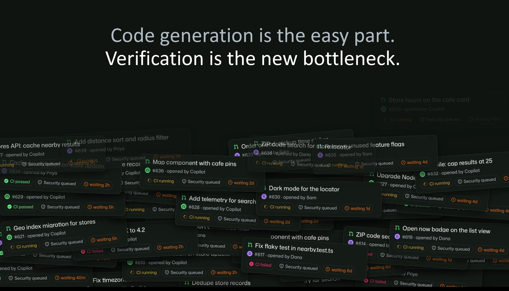

# Verification is the new bottleneck

{ .slide loading=lazy }

With many agents producing pull requests, checking the work is the hard part.

## Details

- Pull requests queue behind CI, security checks and human review.
- The next slides show how checks run in parallel on one pull request.
